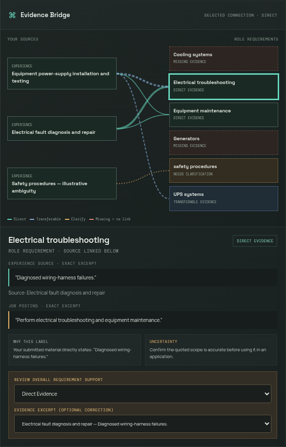
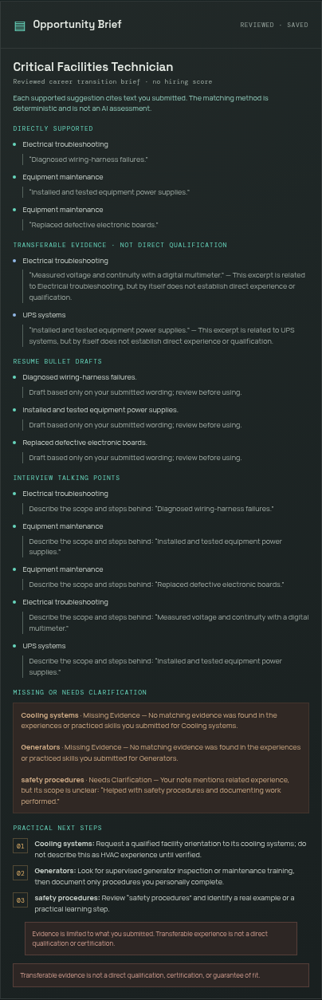
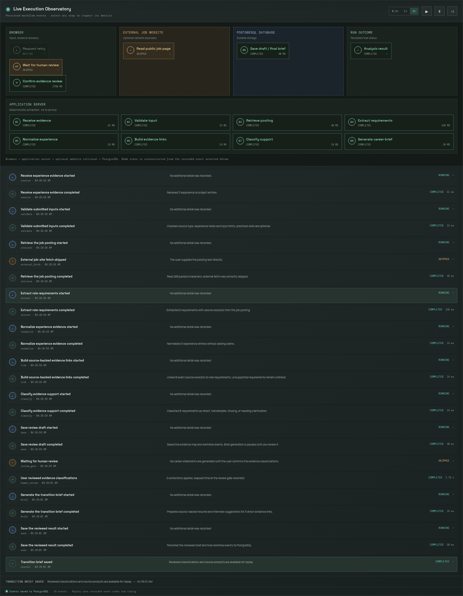
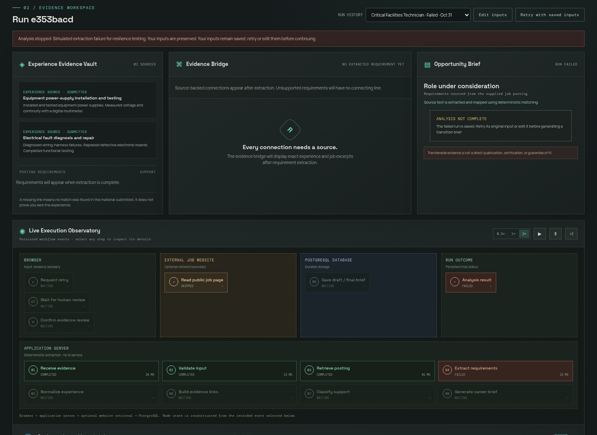
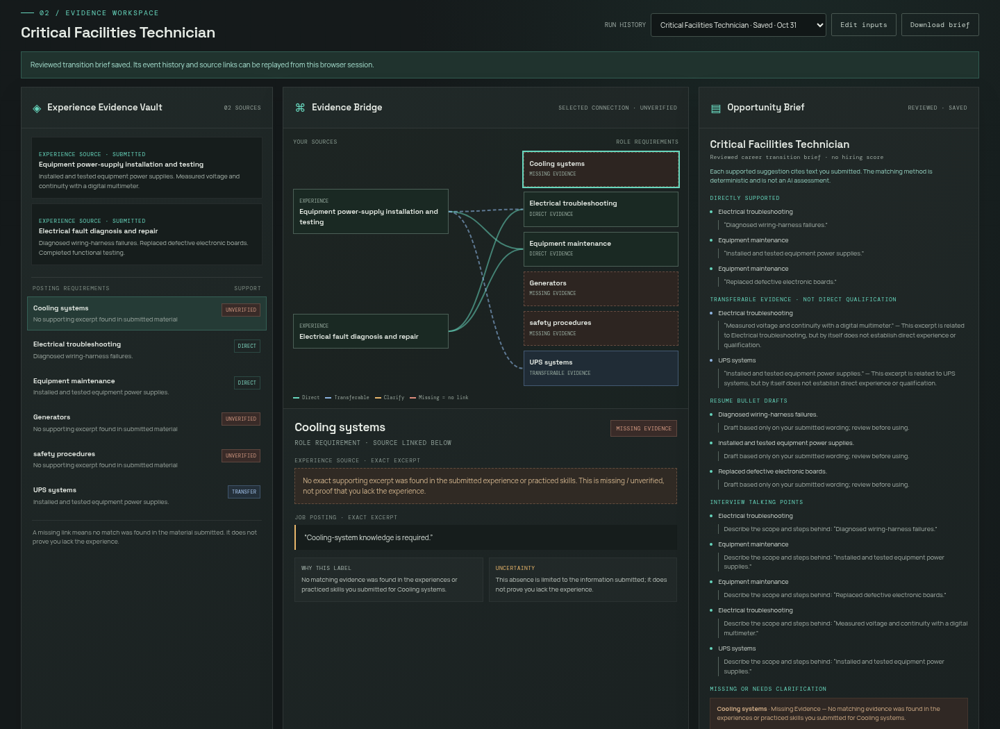
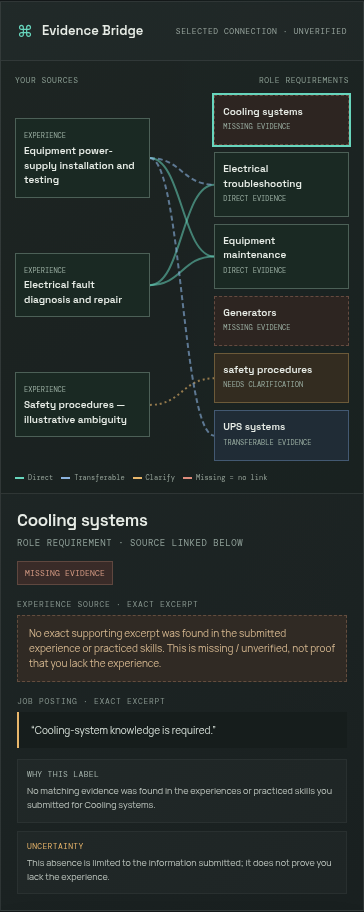
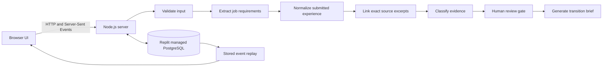

# RIVET — Career Evidence Lab


**Turn real work history into a traceable map of career fit.** RIVET connects exact excerpts from a person's experience to requirements in a target role, distinguishes evidence from gaps, and creates a career-transition brief only after human review.

[Open the public application](https://rivet-career-lab.replit.app) · [Review the production test report](docs/VERIFICATION.md)

> RIVET uses deterministic matching. It does not predict hiring outcomes, score employability, or invent qualifications.

## Product capabilities

- **Evidence Bridge:** inspect source-backed links between experience and job requirements.
- **Four explicit classifications:** Direct Evidence, Transferable Evidence, Missing Evidence, and Needs Clarification.
- **Career Transition Brief:** after human review, generate evidence-backed resume drafts, interview talking points, and practical next steps.
- **Live execution observatory:** inspect actual server events, statuses, timestamps, measured durations, database writes, and final outcomes.
- **Stored replay:** replay a run's persisted event history at 0.5×, 1×, or 2×, with pause and step controls. Replay does not re-run the analysis.
- **Failure recovery:** retain submitted input and the recorded error after a simulated extraction failure, then retry the input as a new run.
- **Private run history:** anonymous browser sessions can only read their own saved runs and event history.

## Screenshots

These are captures from the verified public production application, not mockups.

| Evidence Bridge | Career Transition Brief |
|---|---|
|  |  |

| Live execution observatory | Failure and recovery |
|---|---|
|  |  |



### Mobile



## Illustrative case study

The included demonstration uses **illustrative** manufacturing experience and a Critical Facilities Technician posting; it is not a real user's employment record.

The Evidence Bridge maps six requirements:

| Requirement | Result | Evidence note |
|---|---|---|
| Electrical troubleshooting | Direct Evidence | The submitted experience states “Diagnosed wiring-harness failures.” |
| Equipment maintenance | Direct Evidence | Submitted wording describes installing, testing, and replacing equipment. |
| UPS systems | Transferable Evidence | Power-supply installation and testing relates to UPS work, but does not establish direct UPS qualification. |
| Cooling systems | Missing Evidence | No supporting source excerpt was submitted. |
| Generators | Missing Evidence | No supporting source excerpt was submitted. |
| Safety procedures | Needs Clarification | The illustrative source mentions safety procedures but leaves the scope unclear. |

After human review, the brief offers three source-worded resume drafts, five interview talking points, and three practical next steps. It labels transferable experience as transferable and does not turn missing evidence into a claim that the person lacks that experience.

## Technical architecture



- **Frontend:** static HTML, CSS, and JavaScript served by the Node application.
- **Backend:** Node.js 22.13+ HTTP server and deterministic requirement/evidence processing.
- **Persistence:** Replit managed PostgreSQL stores owner-scoped run inputs, review state, results, and event history. Schema changes are synchronized through Replit Publish; application startup does not run DDL.
- **Events:** server-generated timestamps and statuses; measured durations for executed work; skipped and failed operations are represented explicitly. Server-Sent Events update the live observatory.
- **Privacy:** an anonymous, HTTP-only session cookie scopes run and event endpoints. RIVET does not create user accounts. Submitted source text is stored with its owner-scoped run, not emitted as telemetry.
- **Deployment:** configured for a single-process Replit Reserved VM. The execution worker and live-event registry are process-local; multi-instance deployment needs distributed ownership and event delivery first.

## Run locally

Requirements: Node.js 22.13+ and PostgreSQL.

Create a new, empty **local/development** PostgreSQL database and set `DATABASE_URL` privately in your environment. Then:

```sh
npm ci
psql "$DATABASE_URL" -v ON_ERROR_STOP=1 -f db/schema.sql
npm start
```

The schema file contains structure only, not production data. It is a bootstrap for an empty development database, not a migration for an existing or production database.

The server listens on `PORT` (default `3000`). Do not commit database connection strings. In Replit, use its managed SQL database and publish as a server-backed Reserved VM, not static hosting. Application startup does not alter the schema; managed production schema changes use Replit's Publish flow.

### Source layout

- `server.js`, `store.js`, `workflow.js`, `evidence-engine.js` — active RIVET API, PostgreSQL persistence, recorded workflow, and evidence analysis.
- `public/rivet.html`, `public/rivet.js`, `public/rivet.css`, `public/rivet-diagrams.js` — production RIVET interface. The server maps `/` to `rivet.html` and reports RIVET version 2.0.0.
- `db/schema.sql` — schema-only development bootstrap.
- `tests/` — unit, integration, browser, diagram, and final-demonstration verification.

The finished source retains some legacy helpers and inactive UI files from its MatchMap origin for preservation and regression testing. They are not the production entry point. The original prototype ZIP and design mockup sandbox are not included.

## Tests

```sh
npm test
npm run test:browser
node tests/diagram-verification.mjs
node tests/final-demo.mjs
```

The browser and demonstration tests use Chromium. Use a disposable development database for `npm test`; its integration test starts a server and creates sample runs. For public acceptance testing, set `TEST_BASE_URL` to the deployment URL. Browser tests create their own anonymous sessions and sample runs. Do not run write-producing tests against production merely to verify a repository copy.

See [docs/VERIFICATION.md](docs/VERIFICATION.md) for the actual public v2.0.0 acceptance results and measured replay timings.

## Credits

- **Quindel Logan** — Product Creator, Product Designer, Creative Director, and AI Development Lead.
- **Replit Agent** — implementation assistance.

## Project scope

RIVET's matching is deterministic, not generative AI. Evidence categories describe only what the submitted text supports. A “Missing Evidence” result means no matching source text was found in that run; it is not a conclusion about the person's actual experience. Users must verify every suggested statement before using it.
